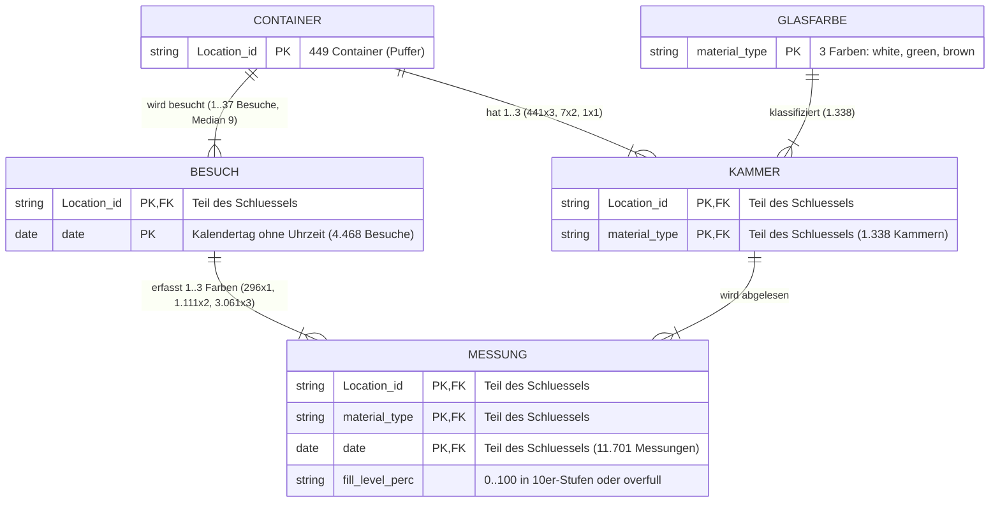

# Domänenmodell der Füllstandsdaten (`glass_fill_levels_anonymized_f.csv`)

Alle Zahlen in diesem Dokument stammen ausschließlich aus `data/raw/glass_fill_levels_anonymized_f.csv` und sind über `scripts/fakten.py` berechnet und belegt.

---

## 1. Reale Entitäten und ihre Schlüssel

Hinter der flachen CSV-Tabelle mit den **4** Spalten `Location_id`, `material_type`, `date` und `fill_level_perc` (`fakten.py`, Abschnitt 1) stehen fünf fachliche Konzepte (vier beobachtete Entitäten plus die nur über Annahme A1 abgeleitete Leerung). Die Benennung folgt `AGENTS.md` §2: **Container** = `Location_id` (Puffer mit Kammern), **Kammer** = `(Location_id, material_type)`:

1. **Container (`Container`, Puffer)**
   - **Bedeutung:** Physischer Sammelplatz (Container-Standort / Sammelinsel) an dem Glascontainer für bis zu **3** Glasfarben stehen. Er bündelt **1–3** Kammern.
   - **Schlüssel:** `Location_id` (`str`).
   - **Anzahl:** **449** (`fakten.py`, Abschnitt 3).
   - **Struktur:** **441** Container umfassen alle **3** Glasfarben, **7** umfassen **2** Glasfarben, **1** umfasst **1** Glasfarbe (`{1: 1, 2: 7, 3: 441}`, `fakten.py` Abschnitt 3).

2. **Glasfarbe (`Glasfarbe`)**
   - **Bedeutung:** Getrennt gesammelte Glasfraktion.
   - **Schlüssel:** `material_type` (`str`, Wertebereich: `'white'`, `'green'`, `'brown'`).
   - **Anzahl:** **3** (`fakten.py`, Abschnitt 3).

3. **Kammer (`Kammer`, in `fakten.py` „Container+Farbe“)**
   - **Bedeutung:** Der konkrete physische Behälter (Puffer) einer bestimmten Glasfarbe in einem Container. Er besitzt einen eigenen Füllstand und eine eigene Füllrate.
   - **Schlüssel:** `(Location_id, material_type)`.
   - **Anzahl:** **1.338** (`fakten.py`, Abschnitt 3; $441 \times 3 + 7 \times 2 + 1 \times 1 = 1.338$).

4. **Besuch (`Besuch`)**
   - **Bedeutung:** Anfahrt eines Containers an einem Kalendertag, bei der mindestens eine Kammer dieses Containers gemessen wird (Zeitstempel hat nur Tagesauflösung ohne Uhrzeit: `False`, `fakten.py`, Abschnitt 1).
   - **Schlüssel:** `(Location_id, date)`.
   - **Anzahl:** **4.468** im Zeitraum `2025-10-17` bis `2026-09-30` (**348** Tage Spannweite; `fakten.py`, Abschnitt 1 & 4).
   - **Struktur:** Bei **3.061** Besuchen wurden **3** Farben gemessen, bei **1.111** Besuchen **2** Farben und bei **296** Besuchen **1** Farbe (`{1: 296, 2: 1111, 3: 3061}`, `fakten.py`, Abschnitt 4). Bezogen auf die **Kammern des Containers** messen nur **3.075** Besuche alle, **1.393** messen eine Teilmenge (`tests/test_domaene.py`).

5. **Messung (`Messung`)**
   - **Bedeutung:** Einzelne Ablesung des Füllstands einer Kammer (`(Location_id, material_type)`) während eines Besuchs (`(Location_id, date)`).
   - **Schlüssel:** `(Location_id, material_type, date)` — eindeutig ohne Duplikate (**0** doppelte `(ID,Farbe,Datum)` und **0** exakte Duplikate, **0** fehlende Werte; `fakten.py`, Abschnitt 1 & 3).
   - **Anzahl:** **11.701** (`fakten.py`, Abschnitt 1).
   - **Messwert (`fill_level_perc`):** Entweder eine der **11** numerischen 10er-Stufen `[0, 10, 20, 30, 40, 50, 60, 70, 80, 90, 100]` (numerisch `> 100`: **0**; genau `100`: **1.953** = **16,7 %**; genau `0`: **2**) oder der Textwert `'overfull'` (**1.192** = **10,2 %**; `fakten.py`, Abschnitt 2).

*(Hinweis zur **Leerung**: In der CSV gibt es keine eigene Spalte für den Leerungsvorgang. Laut `AGENTS.md` Abschnitt 2 wird `Leerungen = Besuche` (**4.468**) über Annahme A1 gesetzt. Der Messwert ist der Füllstand **vor** der Leerung — A5, belegt in `fakten.py` Abschnitt 9.)*

---

## 1b. Integriertes Objektmodell (`Glas` – `Container` – `LKW`)

Reduziert auf drei zusammenarbeitende Objekte der realen Welt, wie in `AGENTS.md` §2
festgelegt und in `src/domaene.py` umgesetzt (Gate: `tests/test_domaene.py`):

1. **`Glas(farbe, menge)`** — der Stoff in `%` Kammervolumen für genau eine der **3** Farben (`'white'`, `'green'`, `'brown'`). Addiert sich nur innerhalb derselben Farbe (`__add__`) und liefert beim `ablesen()` entweder die **10er-Stufe** `0..100` oder `'overfull'` (Annahme A3, rechtszensiert).
2. **`Container(location_id, kammern)`** — einer der **449** Container (`Location_id`), der **1 bis 3** Farb-Kammern (`kammern: dict[str, Kammer]`, insgesamt **1.338** Kammern) bündelt. Die Kammer ist der eigentliche Puffer: eigener Füllstand, eigene Füllrate.
   - `fuellen_bis(tage, raten)` integriert den Zufluss über die vergangenen Tage: `kammer += rate * tage` (Annahme A2).
   - `messen()` liest jede Kammer über `Glas.ablesen()` ab.
   - `leeren()` setzt **alle** Kammern gemeinsam auf `0` zurück (Annahme A1).
3. **`LKW`** — der Akteur (Consumer), der die **449** `Container` anfährt (`besuchen(container, datum)`), **vor** dem Leeren misst (A5: der Messwert ist der Füllstand **vor** der Leerung) und danach **alle** Kammern leert (A1).

**Messen und Leeren sind zwei verschiedene Mengen** (`AGENTS.md` §2, LKW-Zeile). Der
LKW misst eine **Teilmenge** der Kammern und leert **alle**:

| Größe | Wert | Quelle |
|---|---:|---|
| Besuche gesamt | **4.468** | `fakten.py` Abschnitt 4 |
| davon: alle Kammern des Containers gemessen | **3.075** | `tests/test_domaene.py` |
| davon: nur Teilmenge gemessen | **1.393** | `tests/test_domaene.py` |
| Messungen je Besuch: 1 / 2 / 3 Farben | **296 / 1.111 / 3.061** | `fakten.py` Abschnitt 4 |

Ob die **ungemessenen** Kammern bei einem Besuch tatsächlich geleert werden,
entscheidet die CSV nicht: streng A1 (Leerung bei jedem Besuch) ergibt Median
**9,7 Pp**, A4 (Leerung nur bei eigener Messung) **9,9 Pp** — innerhalb des
Rauschens gleich (`fakten.py` Abschnitt 6). A1 bleibt deshalb **gesetzte Annahme,
kein Befund**.

---

## 2. Mermaid-ER-Diagramm

**LKW als Akteur, nicht als Entität.** Der LKW besucht einen Container, misst eine
Teilmenge der Kammern und leert danach **alle** Kammern (A1). Der Besuch ist die
Ereignis-Entität; die Leerung selbst steht nie als Zeile in der CSV (A5).

---

## 3. Mengentabelle mit `pandas`-Belegen (`scripts/fakten.py`)

In den folgenden Ausdrücken ist `d = pd.read_csv("data/raw/glass_fill_levels_anonymized_f.csv", parse_dates=["date"])`, `d["ueber"] = d.fill_level_perc.eq("overfull")` und `d["p"] = pd.to_numeric(d.fill_level_perc.where(~d.ueber))`.

| Entität / Kennzahl | Schlüssel | Anzahl / Wert | `pandas`-Beleg | Quelle (`fakten.py`) |
|---|---|---:|---|---|
| **Standort** | `Location_id` | **449** | `d.Location_id.nunique()` | Abschnitt 3 |
| – davon mit 1 / 2 / 3 Farben | `Location_id` | **1 / 7 / 441** | `d.groupby("Location_id").material_type.nunique().value_counts().sort_index().to_dict()` | Abschnitt 3 |
| **Glasfarbe** | `material_type` | **3** | `d.material_type.nunique()` | Abschnitt 3 |
| **Container** (Container+Farbe) | `(Location_id, material_type)` | **1.338** | `d.groupby(["Location_id", "material_type"]).ngroups` | Abschnitt 3 |
| **Besuch** | `(Location_id, date)` | **4.468** | `d.groupby(["Location_id", "date"]).ngroups` | Abschnitt 4 |
| – davon mit 1 / 2 / 3 gemessenen Farben | `(Location_id, date)` | **296 / 1.111 / 3.061** | `d.groupby(["Location_id", "date"]).material_type.nunique().value_counts().sort_index().to_dict()` | Abschnitt 4 |
| – Besuche je Standort (min / Median / max) | `Location_id` | **1 / 9,0 / 37** | `v.groupby("Location_id").size().agg(["min", "median", "max"])` | Abschnitt 4 |
| – Abstand zwischen Besuchen in Tagen (min / P10 / Median / P90 / max) | `(Location_id, date)` | **1,0 / 12,0 / 26,0 / 56,0 / 222,0** | `v.groupby("Location_id").date.diff().dt.days.quantile([0, .1, .5, .9, 1])` | Abschnitt 4 |
| **Messung** | `(Location_id, material_type, date)` | **11.701** | `len(d)` (sowie `int(d.duplicated(["Location_id", "material_type", "date"]).sum()) == 0`) | Abschnitt 1 & 3 |
| – Messungen `white` / `green` / `brown` | `material_type` | **4.432 / 4.169 / 3.100** | `d.material_type.value_counts()` | Abschnitt 3 |
| – Messungen je Standort (min / Median / max) | `Location_id` | **1 / 24,0 / 97** | `d.groupby("Location_id").size().agg(["min", "median", "max"])` | Abschnitt 4 |
| – Erste Messung je Container (ohne Vorgänger) | `(Location_id, material_type, date)` | **1.338** | `int(d.groupby(["Location_id", "material_type"]).date.diff().dt.days.isna().sum())` | Abschnitt 5 |
| – Messungen mit `'overfull'` (gesamt) | `(Location_id, material_type, date)` | **1.192 (10,2 %)** | `int(d.ueber.sum())`, `d.ueber.mean()` | Abschnitt 2 |
| – Überlauf-Anteil `white` / `green` / `brown` | `material_type` | **16,5 % / 8,6 % / 3,4 %** | `d.groupby("material_type").ueber.mean()` | Abschnitt 3 |
| – Messungen mit genau `100` / genau `0` / `> 100` | `(Location_id, material_type, date)` | **1.953 (16,7 %) / 2 / 0** | `int((d.p == 100).sum())`, `int((d.p == 0).sum())`, `int((d.p > 100).sum())` | Abschnitt 2 |
| – Zeilen für Bilanz-Probe (`~ueber` und `abstand > 0`) | `(Location_id, material_type, date)` | **9.206** | `len(x[~x.ueber & (x.abstand > 0)])` | Abschnitt 6 |

---

## 4. Prüfung der Annahmen A1–A3 gegen die Daten

| Annahme (`AGENTS.md` Abschnitt 3) | Bewertung | Begründung und Beleg aus `scripts/fakten.py` |
|---|---|---|
| **A1:** „Jeder Besuch leert alle Farben der ID auf 0.“ | **Widerlegt** *(Teil „alle Farben“)* / **Nicht prüfbar** *(Teil „leert auf 0“, mit empirischem Gegenbefund)* | **1. „Alle Farben der ID“ ist widerlegt (`fakten.py` Abschnitt 3 & 4):** **441** von **449** Standorten besitzen **3** Farben (`{1: 1, 2: 7, 3: 441}`), aber nur bei **3.061** von **4.468** Besuchen werden alle **3** Farben gemessen (`{1: 296, 2: 1111, 3: 3061}`). Bei **1.407** Besuchen (`SCOPE.md`, $296 + 1.111$) fehlen 1 oder 2 Farben; `brown` hat insgesamt nur **3.100** Messungen gegenüber **4.432** (`white`) und **4.169** (`green`). **2. „Leert auf 0“ ist direkt nicht prüfbar (`fakten.py` Abschnitt 1 & 2):** Die CSV enthält nur eine Messung pro Tag ohne Uhrzeit (`False`) und kein Feld für den Zustand nach dem Besuch. Der Messwert `0` tritt in **11.701** Zeilen nur **2**-mal auf. **3. Indirekter Widerspruch bei kurzen Abständen (`fakten.py` Abschnitt 4, 5 & 6):** Es gibt Besuche im Abstand von nur **1,0 Tag** (`min 1.0`). In der Klasse `<=7` Tage (`n = 291`) beträgt der mittlere Füllstand bereits **45,903 %**, obwohl bei einer Median-Füllrate von **1,52 %/Tag** (P90 **3,89 %/Tag**, Abschnitt 6) nach einer Null-Leerung innerhalb einer Woche deutlich niedrigere Stände zu erwarten wären. |
| **A2:** „Füllrate je Container+Farbe ist zwischen Besuchen konstant (Startwert, wird geprüft).“ | **Widerlegt** | **1. Nichtlineares Abflachen über die Zeit (`fakten.py` Abschnitt 5):** Der mittlere numerische Füllstand (`mittel_fuell`) steigt nur von `<=7` Tagen (**45,903 %**, `n = 291`) über `8-14` Tage (**55,218 %**, `n = 1.305`) bis `15-30` Tage (**63,347 %**, `n = 4.273`), stagniert bei `31-60` Tagen (**63,933 %**, `n = 3.212`) und sinkt bei `>60` Tagen auf **60,861 %** (`n = 1.282`). **2. Hoher Fehler der Bilanz-Probe (`fakten.py` Abschnitt 6):** Selbst in-sample (Median-Rate je Container+Farbe auf allen **9.206** numerischen Folgemessungen) erzeugt `rate_med * abstand` einen mittleren Fehler von **14,4 Prozentpunkten** (Median **9,9 Pp**). Nur **53,2 %** der Fälle liegen innerhalb von `<= 10 Pp` (einer 10er-Stufe), **74,6 %** innerhalb von `<= 20 Pp`. |
| **A3:** „`overfull` = Füllstand ≥ 100 %, genauer Wert unbekannt.“ | **Belegt** *(als rechtszensierter Textwert; exakte Menge dahinter **nicht prüfbar**)* | **1. Rechtszensierung in der Skala belegt (`fakten.py` Abschnitt 2):** Numerische Werte existieren nur in den **11** Stufen `[0, 10, 20, 30, 40, 50, 60, 70, 80, 90, 100]`; es gibt **0** numerische Werte `> 100`. Oberhalb bzw. neben `100` (**1.953** Zeilen = **16,7 %**) steht ausschließlich der Text `'overfull'` (**1.192** Zeilen = **10,2 %**), dessen exakter Prozentwert in der CSV fehlt. **2. Monotones Verhalten als Überlaufzustand belegt (`fakten.py` Abschnitt 3 & 5):** Der `'overfull'`-Anteil wächst streng monoton mit dem Messabstand von **1,0 %** (`<=7` Tage) über **5,3 %** (`8-14`), **10,6 %** (`15-30`) und **13,1 %** (`31-60`) auf **16,6 %** (`>60` Tage). **3. Operative Abgrenzung zu `100` nicht prüfbar (`SCOPE.md` Frage 3):** Wie viel reales Volumen hinter `'overfull'` steckt und wie der Fahrer zwischen `100` (**1.953** Fälle) und `'overfull'` (**1.192** Fälle) unterscheidet, ist aus den **4** Spalten der CSV nicht prüfbar. |
| **A4:** „Jede Messung je (`Location_id`, `material_type`) ist zugleich eine Leerung dieses Containers auf 0; das tägliche Wachstum (`% pro Tag`) bemisst sich aus dem Abstand zur letzten Messung derselben (`Location_id`, `material_type`).“ | **Als Modellregel konsistent mit dem Bilanztest (`tests/test_bilanz.py` grün)** | Löst den Widerspruch der **1.407** Teil-Besuche aus A1 auf: Nicht gemessene Farben werden beim Zwischenbesuch nicht auf `0` gesetzt, sondern füllen ihren Farb-Cache weiter bis zu ihrer nächsten eigenen Messung (`1.010` Messungen mit `abstand_loc != abstand_farbe`, `fakten.py` Abschnitt 6). Damit besteht der Bilanztest (`tests/test_bilanz.py`, alle **4** Tests grün) innerhalb der in `AGENTS.md` §4 festgelegten Grenzwerte (In-Sample $n = 9.206$: Median **9,9 Pp** $\le 10,0$, P90 **36,3 Pp** $\le 37,0$, Mittel **14,4 Pp** $\le 15,0$; Out-of-Sample $n = 5.239$: Median **15,1 Pp** $\le 16,0$, P90 **48,1 Pp** $\le 50,0$). |

---

## 5. Liste der Widersprüche (Daten vs. Modellannahmen und Dokumentation)

1. **Begriffsüberladung „Container“ (`Standort` vs. `Container`) — **gelöst** durch `AGENTS.md` §2:**
   - `AGENTS.md` (Abschnitt 2) und `README.md` setzen `Container = Location_id (449)`.
   - `SCOPE.md` nennt `Location_id` dagegen „Container-Standort“ bzw. „Container-ID“.
   - **Festlegung (AGENTS.md §2, neu):** **Container** = `Location_id` (Puffer mit **1–3** Kammern), **Kammer** = `(Location_id, material_type)` (der einzelne physische Behälter mit eigenem Füllstand und eigener Füllrate, **1.338** in den Daten). `docs/datenmodell.md`, `src/domaene.py` und `docs/modell.md` verwenden diese Benennung; `SCOPE.md` Zeile 36 („Container = Puffer mit Füllrate je ID (und Farbe)“) ist noch nachzuziehen.

2. **Gemeinsame Leerung aller Farben (A1) vs. 1.393 Besuche mit Teilmessung:**
   - Laut `AGENTS.md` (Abschnitt 2 & A1) werden bei einem Besuch alle Kammern einer `Location_id` gemeinsam geleert.
   - Während **441** von **449** Containern alle **3** Farben besitzen (`fakten.py` Abschnitt 3), haben nur **3.061** von **4.468** Besuchen Messungen für alle **3** Farben (`fakten.py` Abschnitt 4). Bei **1.407** Besuchen (**1.111** mit 2 Farben, **296** mit 1 Farbe) fehlen Farben — vor allem `brown` (**3.100** Messungen vs. **4.432** `white` und **4.169** `green`). Bezogen auf die Kammern des Containers sind **1.393** Besuche Teilmessungen (`tests/test_domaene.py`). Ob nicht gemessene Kammern trotzdem geleert wurden, lässt die CSV offen (`SCOPE.md` Offene Frage 2). Die Daten geben beides nicht her: streng A1 ergibt Median **9,7 Pp**, A4 **9,9 Pp** (`fakten.py` Abschnitt 6).

3. **Null-Leerung bei jedem Besuch (A1) vs. 45,9 % Füllstand bei Abständen $\le 7$ Tagen:**
   - Bei einer Median-Füllrate von **1,52 %/Tag** (Median **65,9** Tage bis 100 %, `fakten.py` Abschnitt 6) dürfte ein frisch auf `0` geleerter Container nach wenigen Tagen kaum gefüllt sein.
   - Tatsächlich beträgt der minimale Besuchsabstand **1,0 Tag** (`fakten.py` Abschnitt 4), und die **291** Folgemessungen mit `<=7` Tagen Abstand weisen bereits einen mittleren Füllstand von **45,903 %** auf (`fakten.py` Abschnitt 5). Das deutet auf Kontrollfahrten ohne vorherige Leerung, Teil-Leerungen oder Nachholfahrten für einzelne Farben hin (`SCOPE.md` Offene Frage 1 & 4).

4. **Konstante Füllrate (A2) vs. Stagnation des mittleren Füllstands ab 15–30 Tagen:**
   - Ein lineares Puffermodell (`Rate × Abstand`) verlangt, dass der mittlere Füllstand mit dem Abstand wächst.
   - In den Daten bleibt der mittlere numerische Füllstand ab `15-30` Tagen (**63,347 %**) über `31-60` Tage (**63,933 %**) bis `>60` Tage (**60,861 %**) flach bzw. rückläufig (`fakten.py` Abschnitt 5). Die Bilanz-Probe verfehlt den gemessenen Stand im Mittel um **14,4 Pp** (`fakten.py` Abschnitt 6).

5. **Zensierung durch `'overfull'` (1.192 Zeilen) und Deckelung bei `100` (1.953 Zeilen) in der Ratenberechnung:**
   - In `fakten.py` Abschnitt 6 wird `rate = ok.p / ok.abstand` nur auf den **9.206** numerischen Folgemessungen (`~x.ueber & (x.abstand > 0)`) berechnet.
   - Dadurch fallen alle Überlauf-Intervalle heraus (insgesamt **1.192** `'overfull'`-Zeilen = **10,2 %**, bei `white` sogar **16,5 %**, `fakten.py` Abschnitt 2 & 3), und bei den **1.953** Messungen mit `p == 100` (**16,7 %**) ist unbekannt, wie viele Tage vor dem Besuch die 100-%-Grenze bereits erreicht wurde.

6. **Standorte und Container mit nur 1 Messung (`min 1`) haben kein Intervall:**
   - Sowohl die Anzahl der Messungen je Standort (`min 1`, Median **24,0**, `max 97`) als auch die Anzahl der Besuche je Standort (`min 1`, Median **9,0**, `max 37`) beginnen bei **1** (`fakten.py` Abschnitt 4); konkret haben **7** der **449** Standorte im gesamten Zeitraum nur **1** Besuch (`fakten.py` Abschnitt 7).
   - Jede erste Messung eines Containers (**1.338** Zeilen, `fakten.py` Abschnitt 5) besitzt keinen Vorgänger (`abstand` ist `NaN`). Für die **7** Standorte mit nur **1** Besuch (bzw. Container mit nur einer Messung oder ausschließlich `'overfull'`-Folgemessungen) lässt sich aus den Daten keine Füllrate bestimmen.

7. **Pfadangabe der CSV in `SCOPE.md` vs. `README.md` / `scripts/fakten.py`:**
   - `SCOPE.md` (Zeile 9) nennt den Pfad `data/glass_fill_levels_anonymized_f.csv`, während die Datei im Repository unter `data/raw/glass_fill_levels_anonymized_f.csv` liegt (`README.md`, `scripts/fakten.py`).
